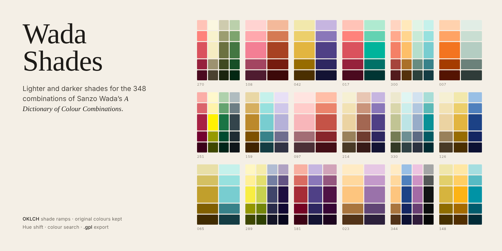

# Wada Shades



A static web app that generates lighter and darker shades for the 348 combinations in Sanzo Wada's
*A Dictionary of Colour Combinations*, with a live preview and export to GIMP Palette (`.gpl`).

## Getting started

Requires Node.js 20 or later.

```sh
npm install
npm run dev        # development server
npm test           # core tests
npm run build      # static build in dist/ (relative base, can be hosted anywhere)
npm run preview    # serve the build locally
npm run cover      # regenerate the README cover (docs/cover.png)
```

## Usage

1. Pick a combination from the list (filter by number of colours, search by name, number or hex).
2. Set how many shades to generate with **Shades** (0 to 8 darker and as many lighter, on every colour), and how
   far apart they are with **Spacing** (see below).
3. Check the preview: one column per colour, with Wada's original colours in the middle row (marked 和田 三造, never
   altered), lighter shades above and darker shades below. Click a shade to copy its hex.
4. Each colour has its own **lighter** stepper above its column and **darker** stepper below it, so one colour can
   have 4 shades and another 2. While the colours differ, the toolbar shows **mixed**, and changing **Shades** asks
   for confirmation before setting every colour back to the same number.
5. Below the grid, the other combinations that use each colour are listed: click one to open it with **Shades** on
   every colour.
6. **Export .gpl** downloads the palette of the selected combination. **Filler** (see the `.gpl` format) pads the
   shorter colours so the original colours line up in one column.
7. The **S/M/L/XL** control above the grid sets the height of the original colours' row; the browser remembers the choice.

The state lives in the URL (`#c=42&d=2&l=2`; when colours have their own counts, `#c=42&n=2&d=4,2&l=2,1` with the
global value in `n` and one count per colour; plus `&s=8` for fixed spacing, `&h=10` for hue shift and `&f=000000`
for the filler), so a configuration can be bookmarked or shared. The browser's Back button returns to the previous
combination.

### Search by colour

Enter a full hex in the search box (`#3a5f8b`, `3a5f8b` or `#abc`), or choose one with the colour picker next to it.
The app shows the 5 closest Wada colours with their perceptual distance (ΔE OK: Euclidean distance in OKLab ×100;
about 2 is the smallest noticeable difference) and orders the list by closeness.
Click one of the matches to show only the combinations that contain it.

### Colour blindness simulation

The **Vision** control (or the `V` key) shows the whole interface as seen with protanopia (no red cones)
or deuteranopia (no green cones). Together with their milder forms, these cover almost all cases of colour blindness:
about 8% of men and 0.4% of women of European ancestry. The simulation uses the Machado, Oliveira and Fernandes (2009)
matrices at full severity, the worst case, applied in linear RGB (`src/core/vision.ts`).
It only changes the view: displayed hex values, copies and exports always keep the real colours.

### Keyboard shortcuts

| Key | Action |
| --- | --- |
| `↓` `J` / `↑` `K` | Next / previous combination in the filtered list |
| `+` / `-` | One more / one fewer shade on every colour |
| `S` | Toggle spacing: spread, fixed |
| `[` / `]` | Smaller / larger fixed step |
| `H` / `Shift+H` | More / less hue shift (2° per press) |
| `V` | Cycle vision: normal, protan, deutan |
| `E` | Export .gpl |
| `/` | Focus the search |
| `Esc` | Clear the search |
| `?` | Show the shortcuts |

## Data

`src/data/colors.json` comes from [mattdesl/dictionary-of-colour-combinations](https://github.com/mattdesl/dictionary-of-colour-combinations)
(MIT, licence in `src/data/`), the same dataset used by
[bravokiloecho/color-combinations-sanzo-wada-public](https://github.com/bravokiloecho/color-combinations-sanzo-wada-public).
Its 159 colours were converted from CMYK with ICC profiles (U.S. Web Coated SWOP v2 → sRGB) and are closer to the printed book
than the original values in [dblodorn/sanzo-wada](https://github.com/dblodorn/sanzo-wada). The file is copied unchanged.

Wada's colour names come from Robert Ridgway's *Color Standards and Color Nomenclature* (1912).
Typos in the dataset are corrected in `NAME_FIXES` (`src/core/data.ts`) rather than in the JSON, so the source stays verifiable:

| Dataset | Corrected |
| --- | --- |
| Rosolanc Purple | Rosolane Purple |
| Pomegranite Purple | Pomegranate Purple |
| Vistoris Lake | Victoria Lake |
| Sulpher Yellow | Sulphur Yellow |
| Krongbergs Green | Kronberg's Green |
| Artemesia Green | Artemisia Green |
| Calamine BLue | Calamine Blue |
| Cerulian Blue | Cerulean Blue |
| Antwarp Blue | Antwerp Blue |
| Vandar Poel's Blue | Vanderpoel's Blue |
| Veronia Purple | Vernonia Purple |
| Eugenia Red \| A, Eugenia Red \| B | Eugenia Red A, Eugenia Red B |
| Grayish Lavender - A, Grayish Lavender - B | Grayish Lavender A, Grayish Lavender B |

Search matches both the corrected and the original name.

## Shade algorithm (`src/core/shades.ts`)

Shades are computed in **OKLCH**, a perceptually uniform colour space:

* **Base colour:** always the dataset's original RGB values, never converted.
* **Lightness:** lighter steps move from the base L towards 0.99 and darker steps towards 0.10.
  How far apart they are depends on the **Spacing** option:
  * **Spread** (default): the room between the base and the limit is split into n + 1 equal parts
    (`L = L_base + (limit − L_base) · i / (n + 1)`). The steps always use the colour's whole range, so few steps are far apart,
    and a colour close to a limit gets small steps on that side.
  * **Fixed**: every step changes lightness by the same amount on every colour, set from 2 to 20 (OKLCH lightness × 100,
    default 8). Good for close, even ramps such as pixel art shading. A step that would pass the limit stops at it,
    and the steps after it repeat that same colour.

  A step that could not move its full amount (it stopped at the limit, or the base is already there, like White)
  is marked **limit** in the preview.
* **Hue:** constant by default. With **Hue shift** (0 to 30 degrees per step), each step rotates hue the short way round:
  lighter steps towards warm yellow (OKLCH hue 100°) and darker steps towards blue violet (280°), the hue shifting used in
  pixel art. The rotation stops at the target hue, and greys, which have no hue, are unchanged.
* **Chroma:** reduced as `C = C0 · (1 − t²)`, where `t` is how far the step is towards the limit (0 at the base, 1 at the limit),
  since white and black have no chroma; it stays almost full near the base colour.
* **Gamut:** colours outside sRGB are brought back by reducing chroma only, keeping L and H
  (culori's `clampChroma`), then rounded to 8 bits.
* **Edge case:** a colour already past the limit (White, L = 1) has nothing lighter, so those steps stay white.

## `.gpl` format

```
GIMP Palette
Name: Sanzo Wada 042
Columns: 5
#
 69  51   0	Yellow Ocher dark 2
146 112   0	Yellow Ocher dark 1
226 181  64	Yellow Ocher
244 203 106	Yellow Ocher light 1
252 228 171	Yellow Ocher light 2
 24  17  50	Violet dark 2
...
```

One row per colour of the combination, ordered from darkest to lightest (`Columns` = steps per row).
When colours have different numbers of shades, the rows are written back to back with no padding and `Columns` is
the longest row, so no colour is repeated. With **Filler** on, the shorter rows are padded with the filler colour
(black by default, named `Filler`) before the darkest and after the lightest shade, so every row has the same
length and the original colours sit in one column. When all colours have the same counts nothing is padded.
File name: `sanzo-wada-042-d2-l2.gpl`; per-colour counts give `-d4.2-l2.1`, fixed spacing adds `-step8`,
hue shift adds `-hue10` and padding with the filler adds `-fill`, for example `sanzo-wada-042-d4.2-l2.1-step8-fill.gpl`.

## README cover

`docs/cover.png` is rendered from the project's own data by `npm run cover`. To change it, edit the combinations and
shade settings at the top of `scripts/cover/cover.ts` (the layout is in `scripts/cover/index.html`), then run the command.
It uses your installed Google Chrome; without it, run `npx playwright install chromium` once, or set `COVER_BROWSER` to
a Chromium executable. The fonts are Bitstream Charter (or Charter / Georgia) and Inter (or the system sans serif),
so the result can differ slightly between systems.

## Project structure

```
src/core/data.ts           dataset, name fixes, the 348 combinations and related combinations
src/core/shades.ts         shade generation
src/core/steps.ts          shades per colour and their URL parameters
src/core/palette.ts        palette of a combination, row alignment, title and file name
src/core/nearest.ts        closest-colour search (ΔE OK)
src/core/vision.ts         protanopia and deuteranopia simulation
src/core/export/           pluggable exporters (gpl; other formats such as a hex list go here)
src/main.ts, style.css     user interface
tests/                     Vitest tests for the core
scripts/cover/, make-cover.mjs   README cover page and the script that renders it
```
